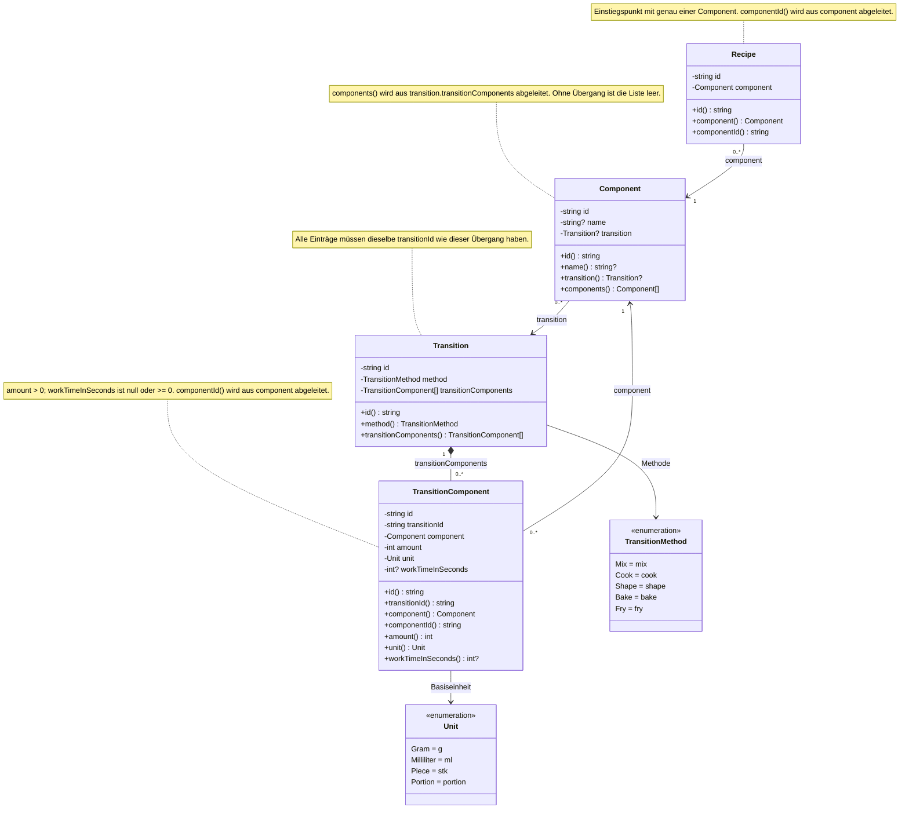

# Konzept: Rezepte als Einstiegspunkte in Komponenten und Übergänge

## Ziel und aktueller Entwurf

Zutaten, Zwischenzustände und fertige Gerichte werden als `Component` beschrieben.
Auch ein vollständiges Gericht ist eine Komponente und kann ohne Typwechsel
als Teil einer anderen Zubereitung verwendet werden. `Recipe` ist ein
Einstiegspunkt, der genau eine solche Komponente referenziert. Die eigentliche
Zusammensetzung und Verarbeitung bleiben im Komponentenmodell.
Ein `Transition` ist eine eigene Entität und beschreibt die Verarbeitung der
verwendeten Komponenten. `TransitionComponent` verbindet eine Komponente mit
einem konkreten Übergang und enthält deren Menge, Einheit und Zeit.

Die Domänenklassen `Component`, `Transition`, `TransitionComponent` und `Recipe`
liegen in `Backend/symfony/src/Domain/Ingredient`. Jede Klasse und jedes Enum
hat eine eigene Datei. Die Klassen sind unveränderlich, kapseln ihre Felder und
verwenden die Enums `Unit` und `TransitionMethod`. Sie sind nicht an Doctrine
angebunden. Die zusätzliche Entität `Recipe` dient ausschließlich als Einstieg
in dieses Modell; Übergänge und Komponentenverwendungen werden weiterhin
eigenständig gespeichert.

## Fachliche Typen

| Typ | Verantwortung |
| --- | --- |
| `Recipe` | Identität eines Einstiegspunkts mit genau einer referenzierten Komponente |
| `Component` | Identität und Name einer Zutat, eines Zwischenzustands oder eines Gerichts; optionaler Übergang und verwendete Unterkomponenten |
| `Transition` | Eigenständiger Übergang mit Identität, Methode und seinen Komponentenverwendungen |
| `TransitionComponent` | Zuordnung von Komponente und Übergang mit benötigter Menge, Basiseinheit und Zeit |
| `Unit` | Fest definierte interne Basiseinheiten als Enum |
| `TransitionMethod` | Fest definierte Methoden als Enum |

`Component` ist der gemeinsame fachliche Typ. „Zutat“ ist eine Rolle eines
bereitgestellten Blatts und keine separate Entität oder Tabelle. Unterschiedliche
Zwischenzustände wie Nudelteig, ungekochte Nudeln und gekochte Nudeln sind
unterschiedliche Komponenten.

Ob eine Komponente als Hauptgericht oder als Teil einer anderen Zubereitung
verwendet wird, verändert ihren Typ und ihre Identität nicht. Beispielsweise
kann dieselbe Tomatensoße über mehrere `TransitionComponent`-Einträge sowohl
beim Vermischen mit Nudeln als auch beim Zubereiten einer Lasagne verwendet
werden. Jeder Eintrag enthält die Angaben für die jeweilige Verwendung.

Jede Klasse, jedes Interface und jedes Enum liegt in einer eigenen Datei.
Fachlicher Zustand bleibt gekapselt und unabhängig von Symfony und Doctrine.

### Recipe als Einstiegspunkt

Jedes `Recipe` referenziert genau eine `Component`. Die Komponente kann ein
vollständiges Gericht, ein Zwischenzustand oder ein bereitgestelltes Blatt sein.
Von ihr aus wird der Graph über ihren Übergang und dessen Komponentenverwendungen
aufgelöst.

Eine Komponente benötigt keinen Recipe-Eintrag, um in anderen Zubereitungen
verwendet zu werden. `TransitionComponent` referenziert weiterhin direkt die
jeweilige `Component`. Beispielsweise kann die Tomatensoße sowohl über einen
Recipe-Einstiegspunkt erreichbar sein als auch als Komponente von Nudeln oder
Lasagne verwendet werden.

Die Zuordnung ist verpflichtend auf der Recipe-Seite. Mehrere Recipe-Einträge
dürfen dieselbe Komponente referenzieren; eine exklusive Zuordnung wurde nicht
vorausgesetzt. Die Datenbank bildet dies mit einem nicht-nullbaren Fremdschlüssel
und einem nicht-eindeutigen Index ab.

### Beziehung zwischen components und transitionComponents

Für den initialen Entwurf gilt die Annahme: `Component.components` ist eine
abgeleitete Sicht auf die Komponenten in `Component.transition.transitionComponents`.
Es wird keine zusätzliche Beziehungstabelle für dieselben Unterkomponenten
angelegt. `TransitionComponent` ist die einzige Quelle für die Zuordnung samt
prozessabhängigen Angaben.

Ein Blatt hat keinen Übergang und keine Unterkomponenten. Ein zusammengesetzter
Zustand verweist auf einen Übergang, dessen Einträge die Unterkomponenten
beschreiben. In einer späteren PHP-Implementierung wäre der Übergang deshalb
optional, auch wenn die vorläufige Skizze ihn noch als nicht-nullbaren Typ enthält.

Falls `Component.components` fachlich eine unabhängige Beziehung darstellen
soll, muss diese Annahme angepasst und eine separate Beziehungstabelle ergänzt
werden. Das wäre eine bewusste Trennung von Zusammensetzung und Prozesszuordnung.

### Eigenständige Übergänge

Die Übergangsmethode wird an `Transition` gespeichert, nicht direkt an
`Component`. Menge, Einheit und Zeit stehen an `TransitionComponent` und hängen
damit von der Kombination aus konkretem Übergang und verwendeter Komponente ab.

Der initiale Entwurf erzwingt keine exklusive Zuordnung eines Übergangs zu genau
einer Ergebniskomponente. Wird derselbe Übergang von mehreren Komponenten
referenziert, teilen diese seine Eingaben einschließlich Mengen und Zeiten.
Ob Übergänge wiederverwendbar oder exklusiv sein sollen, bleibt fachlich offen.

## UML-Klassendiagramm

Das Diagramm bildet die aktuellen PHP-Domänenklassen ab. Alle vier Klassen sind
`final readonly`; ihre Felder sind privat und über öffentliche Methoden lesbar.
IDs sind UUIDs in String-Darstellung, Mengen sind Integer. Ein `?` am Typ
kennzeichnet einen möglichen `null`-Wert. Listen sind als `Typ[]` dargestellt.
Konstruktoren sind zur Übersicht ausgelassen.



Ein Übergang kann im Schema zunächst ohne Einträge angelegt werden. Ein
vollständig definiertes zusammengesetztes Rezept benötigt fachlich mindestens
einen Eintrag. Die Unterkomponenten bilden einen gerichteten Graphen ohne
Zyklen, da sie auch von mehreren Übergängen verwendet werden können.

## Mengen und Zeit

### Verwendung statt globale Eigenschaft

`TransitionComponent` enthält `component_id`, `transition_id`, `amount`, `unit`
und `work_time_in_seconds`. Die Menge ist keine globale Eigenschaft der Komponente.
Auch eine allgemeine Methode wie Kochen besitzt keine feste Menge oder Zeit.

Beispielsweise kann die Verwendung ungekochter Nudeln in einem Kochübergang
mit 100 g und 300 Sekunden definiert sein. In einem anderen Übergang kann
dieselbe Komponente mit einer anderen Menge und Dauer verwendet werden.

Die Zeit liegt gemäß der neuen Skizze an der Komponentenverwendung und nicht
als globaler Übergangsparameter an `Transition`. Eine nicht angegebene Zeit wird
als `NULL` dargestellt; sie ist von einer ausdrücklich angegebenen Dauer von
0 Sekunden zu unterscheiden. Ob dies eine Bearbeitungsdauer oder eine andere
zeitliche Bedeutung beschreibt, muss vor weitergehender Ablaufplanung
präzisiert werden.

### Normalisierung auf Basiseinheiten

Einheiten werden fest als Enum definiert. Intern werden ausschließlich die
festgelegten Basiseinheiten gespeichert, beispielsweise g statt kg und ml statt l.

| Eingabe | Interne Darstellung |
| --- | --- |
| 1 kg | 1000 g |
| 0,5 kg | 500 g |
| 1 l | 1000 ml |
| 0,25 l | 250 ml |
| 2 Stück | 2 stk |
| 5 min | 300 Sekunden in work_time_in_seconds |

Die Normalisierung erfolgt vor der fachlichen Verarbeitung und Speicherung.
Die ursprüngliche Eingabeeinheit muss dafür nicht gespeichert werden. Eine
Rückumrechnung für die Anzeige verändert den gespeicherten Wert nicht.

Mengen werden als positive Integer gespeichert. Der SQL-Entwurf verwendet
`INT UNSIGNED` für `amount`, passend zum `int` der PHP-Skizze.

Eine Eingabe wie 0,5 kg bleibt möglich, weil die Normalisierung 500 g ergibt.
Der normalisierte Wert muss jedoch ganzzahlig sein: 0,5 g oder ein halbes Stück
sind mit den derzeitigen Basiseinheiten nicht direkt darstellbar. Solche Werte
müssen vor dem Speichern validiert werden; eine implizite Rundung durch die
Datenbank soll nicht als fachliche Regel dienen. Die Behandlung von Bruchteilen
bei späterer Skalierung ist noch ausdrücklich festzulegen.

Gramm und Milliliter bleiben unterschiedliche Dimensionen. Eine Umrechnung
benötigt die bekannte Dichte der jeweiligen Komponente. „Portion“ ist eine
rezeptbezogene Einheit und benötigt für die Umrechnung beispielsweise eine
bekannte Portionsmasse. Ein festes Enum ersetzt solche fachlichen Definitionen
nicht. Fehlende Umrechnungsinformationen werden nicht stillschweigend geschätzt.

## Beispiel: Nudeln mit Tomatensoße

Der Recipe-Einstiegspunkt referenziert die Komponente „Nudeln mit Tomatensoße“.
Die folgende Darstellung beginnt bei dieser Komponente und zeigt ihren Graphen.

```text
Component: Nudeln mit Tomatensoße
└── Transition: vermischen
    ├── TransitionComponent: gekochte Nudeln, 100 g
    │   └── Component: gekochte Nudeln
    │       └── Transition: kochen
    │           └── TransitionComponent: ungekochte Nudeln, 100 g, 300 s
    │               └── Component: ungekochte Nudeln
    │                   └── Transition: formen
    │                       └── TransitionComponent: Nudelteig, Menge offen
    │                           └── Component: Nudelteig
    │                               └── Transition: mischen
    │                                   ├── Wasser: 100 ml
    │                                   ├── Mehl:   100 g
    │                                   ├── Eier:     2 stk
    │                                   └── Salz:     1 Prise
    └── TransitionComponent: Tomatensoße, 50 g
        └── Component: Tomatensoße
            └── Transition: kochen, Komponenten noch offen
```

Wasser, Mehl, Eier und Salz sind ebenfalls über `TransitionComponent` mit dem
Mischübergang verbunden. In der Darstellung sind diese unteren Einträge nur
verkürzt notiert. „100 ml Wasser“ ist keine Mengenangabe am Wasser selbst.

Das Beispiel beschreibt lokale Definitionen, keine vollständig skalierte
Einkaufsliste. 100 g ungekochte Nudeln und 100 g gekochte Nudeln sind
unterschiedliche Bezugsgrößen. Ausbeuten beziehungsweise Umrechnungen zwischen
solchen Zwischenzuständen sind in den drei vorläufigen Klassen noch nicht
enthalten und werden im initialen Schema nicht zusätzlich vorausgesetzt.

Für die Auflösung auf eine gewünschte Ergebnismenge muss diese Information
später ergänzt werden. Sie kann nicht allgemein durch Addition der Eingaben
ermittelt werden. Die Zeit einer Verwendung wird bei einer Mengenskalierung
nicht automatisch mit multipliziert.

„Prise“ benötigt entweder eine ausdrückliche komponentenspezifische Definition
für die Umrechnung in Gramm oder eine Entscheidung für eine eigene interne
Zähleinheit. Bis zu dieser Entscheidung ist sie nicht im initialen SQL-Enum
enthalten; der Beispieleintrag ist deshalb noch nicht vollständig persistierbar.

## Initiale Skeema-SQL-Dateien

Der deklarative Entwurf besteht aus vier Tabellen:

| Datei | Daten |
| --- | --- |
| [recipe.sql](../Backend/symfony/schema/recipe.sql) | Identität eines Einstiegspunkts und genau ein verpflichtender component_id-Verweis |
| [component.sql](../Backend/symfony/schema/component.sql) | Identität, Name und optionaler transition_id-Verweis |
| [transition.sql](../Backend/symfony/schema/transition.sql) | Identität und Methode des eigenständigen Übergangs |
| [transition_component.sql](../Backend/symfony/schema/transition_component.sql) | Komponentenverwendung mit Menge, Einheit und Zeit |

Jede Datei enthält eine vollständige `CREATE TABLE`-Definition samt Indizes und
Constraints. Es gibt keine nummerierten Migrationsschritte oder
Transaktionsanweisungen. Die Tabelle `recipe` enthält ausschließlich den
Einstiegspunkt; die frühere Struktur mit Übergangs- und Mengenfeldern direkt am
Rezept ist nicht Bestandteil dieses Entwurfs.

Alle Primär- und Fremdschlüssel verwenden UUIDs. Im SQL-Entwurf werden sie als
`BINARY(16)` mit 16 Bytes gespeichert. Referenzen verwenden exakt dieselbe
Definition wie die jeweiligen Primärschlüssel. `transition_id` bleibt bei
Blattkomponenten optional.

UUIDs werden bei der späteren Implementierung vor dem Speichern erzeugt und
validiert. Die lesbare String-Darstellung in PHP wird im Persistenzadapter in
die 16-Byte-Darstellung umgewandelt und beim Laden wieder zurückübersetzt.
Primär- und Fremdschlüssel müssen dieselbe Byte-Reihenfolge verwenden. Es gibt kein
`AUTO_INCREMENT` und keine automatische UUID-Erzeugung durch die Datenbank.
Die konkrete UUID-Version und ihre Erzeugung sind noch festzulegen. Der
`BINARY(16)`-Typ allein validiert keine fachlich gültige UUID; Validierung und
Konvertierung sind noch nicht implementiert oder angebunden.

Skeema unterstützt MySQL und MariaDB, nicht die bestehende PostgreSQL-Datenbank.
Die Dateien verwenden MySQL-8.4-Syntax. Die vorhandene Datenbank sowie Docker-
und Doctrine-Konfiguration bleiben unverändert.
Quelle: [Skeema-Dokumentation](https://www.skeema.io/docs/).

Die Dateien wurden nicht ausgeführt und sind nicht an Verbindungsprofile,
Doctrine-Migrationen, PHP-Persistenzmodelle, Backend-Start oder Tasks angebunden.

Positive Mengen, gültige Enum-Werte und vorhandene Referenzen werden durch
lokale Constraints abgesichert. Alle Fremdschlüssel verwenden restriktives
Löschverhalten. Es gibt keine automatische Löschkaskade.

## Validierung und offene Entscheidungen

Vor einer späteren Anbindung müssen insbesondere diese Punkte festgelegt oder
implementiert werden:

- Zyklen über Component -> Transition -> TransitionComponent -> Component
  verhindern; dies betrifft auch unmittelbare Selbstverwendung.
- Vollständige Übergänge mit mindestens einer Komponentenverwendung prüfen.
- Zulässige Einheiten, Methoden sowie komponentenspezifische Umrechnungen
  definieren.
- Die Bedeutung und Anforderungen der Zeitangabe je Komponentenverwendung
  festlegen.
- Ausbeuten für die Skalierung über Zwischenzustände ergänzen.
- Festlegen, ob Übergänge zwischen mehreren Ergebniskomponenten geteilt werden
  dürfen.
- Die Ableitung von `Component.components` bestätigen oder eine unabhängige
  Beziehung definieren.
- UUID-Version, Erzeugung und Formatvalidierung sowie die Behandlung
  nicht-ganzzahliger Ergebnisse bei Normalisierung und Skalierung festlegen.

Die initialen SQL-Dateien erzwingen noch nicht alle Regeln über mehrere
Datensätze. Das Diagramm und die SQL-Dateien beschreiben einen Entwurf, keine
bereits angebundene oder vollständige fachliche Implementierung.
